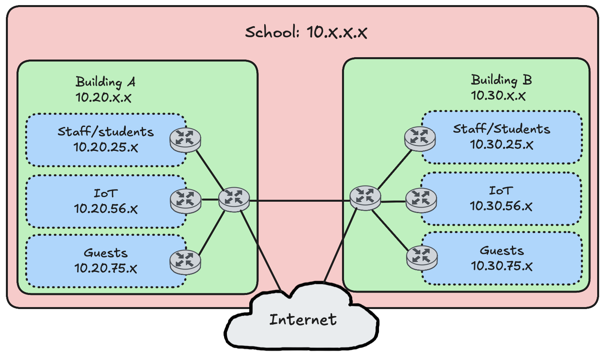
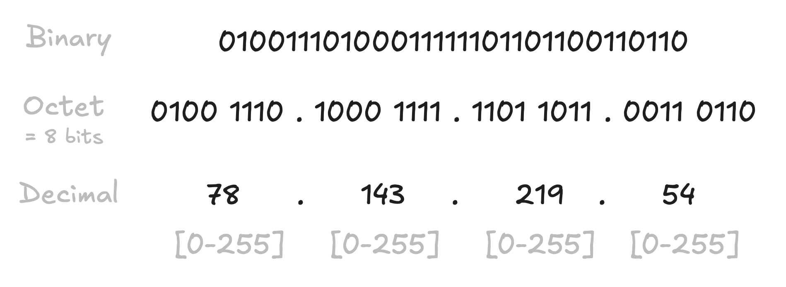
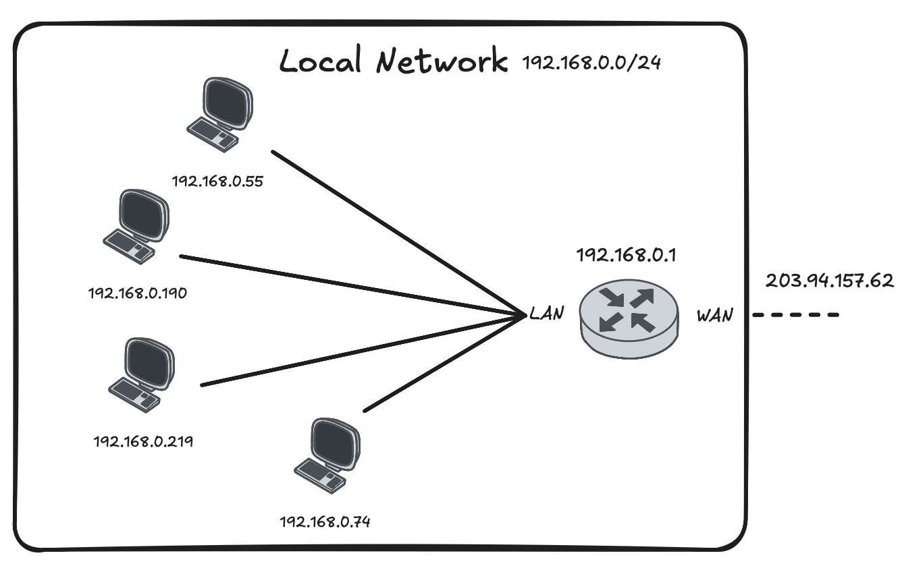

<div class="title-card">
    <h1>IP Addresses</h1>
</div>

---

# IP Addresses 

Unique identifier within its network, like a postal address of a device on a network.

- Every packet carries a sender and a recipient address, like a letter

- Routers act like sorting centres: they read the recipient address and pass the packet one step closer to its destination.

- The address describes *where* you are, not *who* you are: move your laptop to another network and it gets a new IP address.

---

# Private vs Public IP Addresses

- **Public IP addresses** are routable on the global internet.

- **Private IP addresses** are used within local networks and are not directly accessible from the internet.




---

# Translating from binary to decimal

Example address: `192.168.1.42`. Four numbers from 0–255, each one is 8 bits (32 bits in total):




---

# Check your public IP address

Many websites can show you your public IP address. For example:

https://myip.dk/

Or you can do it from the command line:

```bash
$ curl -4 ifconfig.me
$ curl -4 icanhazip.com
```

---

# Check your local / private IP address

**MacOS**:

```bash
$ ifconfig
```

Look for the `en0` or `en1` interface.

The IP address is next to `inet`.

**Windows**:

```bash
$ ipconfig
```

Look for the `IPv4 Address` line under your active network interface. The IP address will be listed next to it.

**Linux**:

```bash
$ ip addr show
```

---

# Private IP Address Ranges ([RFC 1918](https://www.rfc-editor.org/rfc/rfc1918#section-3))

Three blocks are reserved for **private networks**. They are *not* routable on the public internet.

| Range (CIDR) | Address span | # addresses | Where you'll see it |
|---|---|---|---|
| `10.0.0.0/8` | `10.0.0.0` – `10.255.255.255` | ~16.7 million | Large networks (e.g. at EK) |
| `172.16.0.0/12` | `172.16.0.0` – `172.31.255.255` | ~1 million | iPhone hotspot (`172.20.10.x`), some VPNs & Docker |
| `192.168.0.0/16` | `192.168.0.0` – `192.168.255.255` | ~65,000 | Most home routers, Android hotspots |

> Because everyone reuses these ranges privately, two different networks can both use `192.168.0.1` without conflict.

---

# Translating private to public IP addresses (NAT)

- Devices within a private network use private IP addresses to communicate with each other.

- To access the internet, these private IP addresses need to be translated to a public IP address.

- This is done using a technique called **NAT** (**N**etwork **A**ddress **T**ranslation), typically performed by a router.

- The router maintains a table to keep track of which private IP address and port corresponds to which public port.

---

# NAT Example

The router keeps a NAT table. Two computers visit the same website, and the router tells them apart by the public port it assigns:

```plaintext
Private IP:port        Public IP:port         Destination
---------------------------------------------------------------
192.168.0.55:51000     203.94.157.62:40001    142.251.9.102:443
192.168.0.190:51000    203.94.157.62:40002    142.251.9.102:443
```

When a reply arrives at `203.94.157.62:40002`, the router looks it up and forwards it to `192.168.0.190:51000`.



*You open the same website in two browser tabs. How does the router tell the two connections apart?*

<details> 
  <summary>Answer</summary>
   A different public port is assigned to each connection.
</details>

---

# IPv4 vs. IPv6 Address Space
**IPv4**:
- Approximately 4.3 billion addresses (2^32).
- The range of IP addresses is from `0.0.0.0` to `255.255.255.255`.
- Some addresses are reserved for a special purpose:
    - Loopback addresses: (`127.0.0.1`)

**IPv6**:
- Approximately 3.4 × 10^38 addresses (2^128).
- This is enough for every grain of sand on Earth to have its own IP address.


---

# Install Dig

Dig is a powerful command-line tool for performing DNS lookups.

## MacOS

Already installed.

## Linux (Debian/Ubuntu)

```bash
$ sudo apt install dnsutils
```

## Windows

Not built in. Install it with Scoop:

```powershell
$ scoop install bind
```

Alternatively, run dig in a Docker container:

```bash
$ docker run -it jonlabelle/network-tools bash
4aa7b408e01c:/# dig +short A ek.dk
195.254.168.52
```

---

# Check if a website supports IPv6

```bash
$ dig +short A google.com       # IPv4: 142.251.9.102 ...
$ dig +short AAAA google.com    # IPv6: 2a00:1450:4025:c03::8a ...
$ dig +short AAAA ek.dk         # (empty): ek.dk is IPv4 only
```

---

<div class="title-card">
    <h1>Subnetting</h1>
</div>

---

# Subnetting

**Subnetting**: Dividing a larger network into smaller, more manageable sub-networks (subnets).

Improves network performance and security by reducing broadcast traffic and isolating network segments.

---

# Subnet Masks - Example 1

A subnet mask marks which part of an IP address is the network part (the street) and which is the host part (the house number).

The `1`-bits in the mask mark the network part:

```plaintext
IP address:  192      .168      .1        .42
Mask:        255      .255      .255      .0
             11111111 .11111111 .11111111 .00000000
             └────────── network ───────┘ └─ host ─┘
```

- 24 network bits, 8 host bits → 2^8 = `256` addresses: `192.168.1.0` – `192.168.1.255`
- First address `192.168.1.0` = network address (identifies the subnet itself)
- Last address `192.168.1.255` = broadcast address (reaches every device on the subnet)
- That leaves `254` usable addresses for devices

---

# Subnet Masks - Example 2

Same IP, smaller subnet: mask `255.255.255.240`

```plaintext
255      .255      .255      .240
11111111 .11111111 .11111111 .11110000
   8     +   8     +   8     +   4      = 28 network bits, 4 host bits
```

- 4 host bits → 2^4 = `16` addresses: `.42` falls in the block `192.168.1.32` – `192.168.1.47`
- Network address `.32`, broadcast address `.47` → `14` usable

CIDR notation (Classless Inter-Domain Routing) just counts the `1`-bits in the mask and adds them after the `/` symbol: `192.168.1.42/28`

---

# Subnet Masks - Overview

More subnet masks and their CIDR notation:

| Mask | CIDR | Host bits | Addresses | Usable |
|---|---|---|---|---|
| `255.255.0.0` | `/16` | 16 | 65,536 | 65,534 |
| `255.255.255.0` | `/24` | 8 | 256 | 254 |
| `255.255.255.240` | `/28` | 4 | 16 | 14 |

---

# Subnet calculation example

Given the IP address: `192.168.10.75/26`

1. Host bits: 32 − 26 = `6`
2. Subnet size: 2^6 = `64` addresses
3. Subnets of 64 start at multiples of 64 (`.0`, `.64`, `.128`, `.192`) → `.75` is in the range of `.64` – `.127`.
4. The first address (`192.168.10.64`) in that subnet is reserved for the network address and the last (`192.168.10.127`) is the broadcast address.

| | Answer |
|---|---|
| Subnet mask | `255.255.255.192` |
| Network address | `192.168.10.64` |
| Broadcast address | `192.168.10.127` |
| Usable range | `192.168.10.65` – `192.168.10.126` (62 hosts) |

---


# Finding the subnet mask of your current network

**MacOS**: look for the `inet` line. The netmask is in hex. 

Example: `0xffffff00` = `255.255.255.0`.

```bash
$ ifconfig en0
```

**Linux**: the mask is shown as CIDR. 

Example: `inet 192.168.1.42/24`.

```bash
$ ip addr show
```

**Windows**: look for `IPv4 Address`, `Subnet Mask` and `Default Gateway`. 

Example: `IPv4 Address: 192.168.1.42`, `Subnet Mask: 255.255.255.0`, `Default Gateway: 192.168.1.1`.

```bash
$ ipconfig
```
