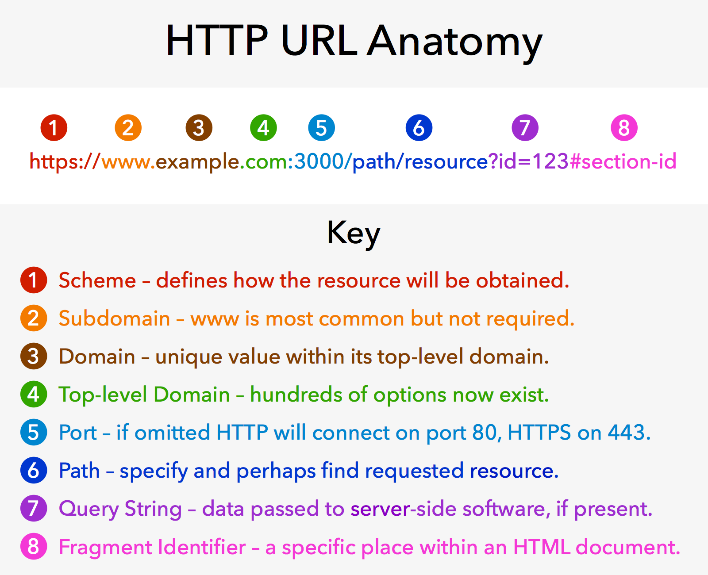

<div class="title-card">
    <h1>Hostnames</h1>
</div>

---

# Hostnames

*Why would one use hostnames (domain names) instead of IP addresses?*

---

# Why separate Names and IP Addresses?

| | Why | Example |
|---|---|---|
| **Memorability** | Domain names are easier for humans to remember than numerical IP addresses. | `www.ek.dk` vs `20.50.2.66` |
| **Flexibility** | IP addresses can change (e.g. when a website moves to a different server), but the domain name can remain the same. | Moving `www.ek.dk` to a new IP address doesn't require users to learn a new address. |
| **Scalability** | A single domain name can point to multiple IP addresses (e.g., for load balancing or redundancy). | `www.ek.dk` can resolve to multiple servers to handle more traffic. |
| **Aliases** | Several names can lead to the same place. | `www.ek.dk`, `ek.dk` point to the same IP address. |

---

# Whois

To learn more about a domain name and the person / organization that registered it, you can use the `whois` command (not installed on Windows).

```bash
$ whois ek.dk
```

You can also try online tools like https://www.whois.com/

[Fun fact](https://entrepreneurship.babson.edu/magazine-archive/2016/02/05/the-man-who-bought-google-com/). A former Google employee, purchased the google.com domain name for $12 in 2016 and held on to it for a minute. He was rewarded with the amount `$6,006.13` (which spells Google) which he donated to charity and the domain name was returned to Google. The expiration date is visible in the whois ouput.


---

# URL Anatomy



[Source](https://nikolas-has-english.blogspot.com/2022/04/what-are-different-parts-of-url-explain.html)

**Note**: Protocol is a more general name rather than scheme.

URL Quiz Homework: https://anderslatif.github.io/URL_anatomy/

