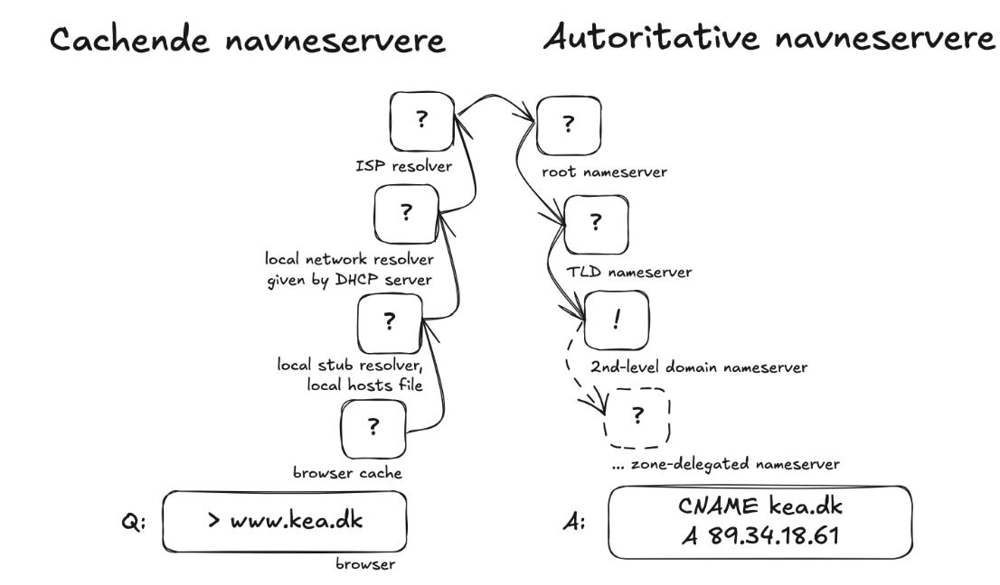

<div class="title-card">
    <h1>DNS</h1>
</div>

---

# Domain Name System (DNS)

**Problem:** How do we translate domain names to IP addresses?

**Solution:** A hierarchical and distributed database that maps domain names to IP addresses.

**Analogy**: DNS is a phonebook for the internet.

---

# First approach: Centralized server

- A single server that maintains a database of domain names and their corresponding IP addresses.

- When a user wants to access a website, their computer queries this central server to get the IP address.

- All queries go to this one server.

*What are the potential issues with this approach?*

---

# Domain Name System (DNS)

- Instead of a centralized server, DNS uses a **distributed** and **hierarchical** approach.

- DNS is made up of many servers around the world, each responsible for different parts of the domain name space.

- When a user wants to access a website, their computer queries multiple DNS servers in a **hierarchical** manner to resolve the domain name to an IP address.

---

# DNS Hierarchy

**DNS hierarchy is organized in levels:**

| Level | Description | Examples |
| --- | --- | --- |
| **Root Level** | The top level, represented by a trailing dot `.` in FQDN (Fully Qualified Domain Names). | `.` |
| **Top-Level Domains (TLDs)** | Below the root, such as generic and country-code TLDs. | `.com`, `.org`, `.net`, `.dk`, `.uk`, `.jp` |
| **Authoritative Servers** | Each TLD has authoritative servers that manage the next level down, which includes second-level domains. | `ek` in `ek.dk` |

> The root server doesn't know the IP address of `ek.dk`. It knows the IP address for the `.dk` TLD is contains the authoritative server for `ek.dk`.

---

# DNS Hierarchy - Diagram


[Source](https://blog.bytebytego.com/p/a-crash-course-in-dns-domain-name)

*What TLDs can you list?*

---

# Root name servers

From [this website](https://root-servers.org/):

> As of 2026-10-19T12:24:36Z, the root server system consists of 2047 operational instances operated by the 12 independent root server operators.

> The 13 root name servers are operated by 12 independent organisations.


<!-- https://www.internic.net/zones/named.root 
https://www.internic.net/domain/root.zone  -->


---


# Manual DNS lookups

Your browser automatically handles DNS lookups for you. 

Before we dive into the details of the resolution process, let's try to perform it manually. 

## Command-line tools

| Tool | Windows | Mac | Linux | Notes |
|------|---------|-----|-------|-------|
| nslookup | Yes | Yes | Yes | Available on all platforms |
| host | WSL | Yes | Yes | Unix/Linux standard |
| dig | Install with `scoop` | Yes | Yes | Most powerful; part of BIND Tools |

## Online tools

- [DNSChecker.org](https://dnschecker.org): Check DNS records across multiple servers globally
- [MXToolbox](https://mxtoolbox.com/SuperTool.aspx): Comprehensive DNS diagnostics and tools
- [What's My DNS](https://whatsmydns.net): Global DNS propagation checker
- [DNSlookup.fr](https://dnslookup.fr): Simple, fast DNS lookup

---

# nslookup

This is an example output of running `nslookup ek.dk` in the terminal:

```bash
$ nslookup ek.dk      
Server:		2606:4700:4700::1111
Address:	2606:4700:4700::1111#53

Non-authoritative answer:
Name:	ek.dk
Address: 195.254.168.52
```

*What is the IP address of `ek.dk`? Does it reach to `ek.dk`?*

The port number is `53`, which is the default port for DNS queries.

*What is the domain name server used for the lookup?*

*Which addresses are ipv4 and which are ipv6?*

The answer is non-authoritative, meaning that the response comes from a cached copy of the DNS record rather than from a DNS server owned by `ek.dk`.

---

# nslookup - II

*What happens when you look up `www.ek.dk` instead? Which cloud provider is it hosted on?*

**Note**: EK hosts their DNS at `ns.efif.dk` run by `it-driftsfællesskabet EFIF`.

---

# Ping

`nslookup` is a DNS lookup tool and doesn't actually reach the server. We could use `ping` to see if the server is reachable.

`ek.dk` does not support ICMP (the protocol used by `ping`), so you cannot ping it.

Instead, let's ping Google's DNS server:

```bash
$ ping 8.8.8.8
```

Remember: `CTRL+C` to stop the ping.

*What is the data loss percentage? What is the average round-trip time?*

---

# DNS Caching

Instead of having to reach the authorative nameservers for `ek.dk` every time, there are several layers of caching in place.

Non-authorative answers can be given at any time by the following process:

1. Does your browser remember the IP address of `ek.dk` from a previous visit?

2. Does your operating system have a cached entry for `ek.dk`?

3. Does your local router have a cached entry for `ek.dk`?

4. Does your ISP have a cached entry for `ek.dk`?

**If not**, then ask the authoritative nameservers.

---

# Caching vs. Authorative nameservers

This is the route taken when looking up `ek.dk`. It can exit at any point if a cached entry is found.

<!-- todo update the image -->



---

# TTL (Time To Live)

During lookups numbers such as `3600`, `86400`, `172800` may appear. These are the amount of seconds that a record is cached before the cache will be renewed.

Pros and cons (the pro in one case is a con in the other):

**High TTL**:

* (+) Cashing for longer ensures quicker responses.

**Low TTL**:

* (+) Changes to DNS records will propagate faster.

**Note**: The term TTL exists in TCP (next week's topic) but means something different. You can remember it by:

**TTL in DNS**: Time To Live for a cached record in actual seconds.

**TTL in TCP**: Time To Live for a packet, measured in hops (routers) and should've rather been called `hop count`.