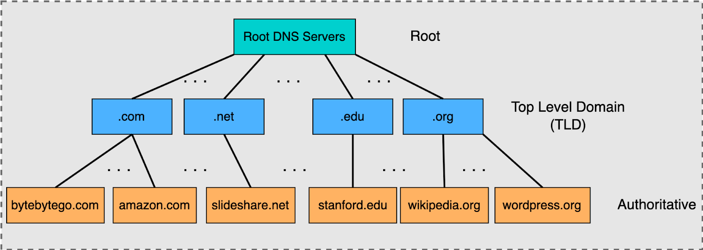
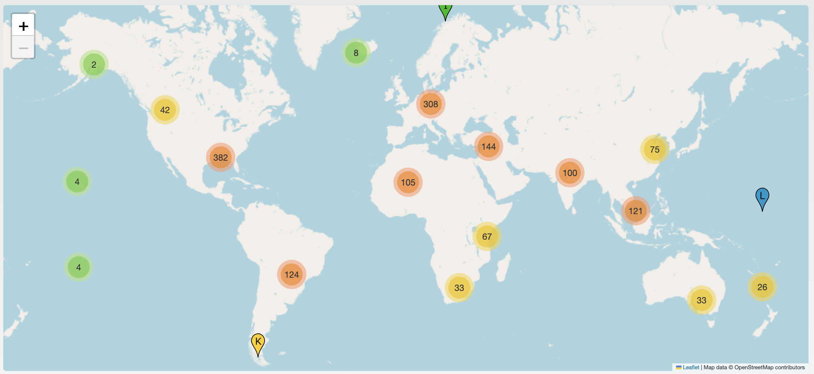

<div class="title-card">
    <h1>DNS</h1>
</div>

---

# Domain Name - IP Address Mapping

**Problem**: How do we translate domain names to IP addresses?

**Solution**: A database that maps domain names to IP addresses.

**Analogy**: Domain Name System (DNS) is a phonebook for the internet.

---

# First approach: Centralized server

- One server

- One database of all domain names and their IP addresses

- Every lookup in the world goes to this server

*What are the potential issues with this approach?*

---

# Domain Name System (DNS)

- **Distributed**: many servers around the world instead of one

- **Hierarchical**: each server is responsible for its own part of the names (`.dk`, `ek.dk`, …)

- Your computer asks a resolver, which works its way down the hierarchy to find the IP address

---

# DNS Hierarchy

**DNS hierarchy is organized in levels:**

| Level | Description | Examples |
| --- | --- | --- |
| **Root Level** | The top level, represented by a trailing dot `.` in an FQDN (Fully Qualified Domain Name). | `.` |
| **Top-Level Domains (TLDs)** | Below the root: generic (gTLD) and country-code (ccTLD). | gTLD: `.com`, `.org`, `.net`. ccTLD: `.dk`, `.uk`, `.jp` |
| **Second-Level Domains** | Below a TLD, registered by organizations. Each has its own authoritative servers. | `ek` in `ek.dk` |

> The root server doesn't know the IP address of `ek.dk`. It knows where the `.dk` servers are, and they know where the authoritative server for `ek.dk` is.

---

# DNS Hierarchy - Diagram



[Source](https://blog.bytebytego.com/p/a-crash-course-in-dns-domain-name)

*What TLDs can you list?*

---

# Root name servers

From [this website](https://root-servers.org/):

> The 13 root name servers are operated by 12 independent organisations.

The 13 servers are named `a.root-servers.net` – `m.root-servers.net`.

> As of 2026-10-19T12:24:36Z, the root server system consists of 2047 operational instances operated by the 12 independent root server operators.




<!-- https://www.internic.net/zones/named.root 
https://www.internic.net/domain/root.zone  -->


---

# Manual DNS lookups

Your browser automatically handles DNS lookups for you. 

Before we dive into the details of the resolution process, let's try to perform it manually. 

## Command-line tools

| Tool | Windows | Mac | Linux | Notes |
|------|---------|-----|-------|-------|
| nslookup | Yes | Yes | Yes | Available on all platforms |
| host | WSL | Yes | Yes | Unix/Linux standard |
| dig | `scoop install bind` | Yes | `apt install dnsutils` | Most powerful; part of BIND Tools |

---

# Online tools

- [DNSChecker.org](https://dnschecker.org): Check DNS records across multiple servers globally
- [MXToolbox](https://mxtoolbox.com/SuperTool.aspx): Comprehensive DNS diagnostics and tools
- [What's My DNS](https://whatsmydns.net): Global DNS propagation checker
- [DNSlookup.fr](https://dnslookup.fr): Simple, fast DNS lookup

---

# nslookup

This is an example output of running `nslookup ek.dk` in the terminal:

```bash
$ nslookup ek.dk      
Server:		2606:4700:4700::1111
Address:	2606:4700:4700::1111#53

Non-authoritative answer:
Name:	ek.dk
Address: 195.254.168.52
```

*What is the IP address of `ek.dk`?*

*Does the IP address reach `ek.dk`?*

The port number `#53` is the default port for DNS queries.

*What is the domain name server used for the lookup?*

*Which addresses are IPv4 and which are IPv6?*

The answer is non-authoritative, meaning that the response comes from a cached copy of the DNS record rather than from the authoritative DNS server for `ek.dk`.

---

# nslookup - II

*What happens when you look up `www.ek.dk` instead? Which cloud provider is it hosted on?*

**Note**: EFIF (`it-driftsfællesskabet EFIF`) hosts their DNS at `ns.efif.dk`.

