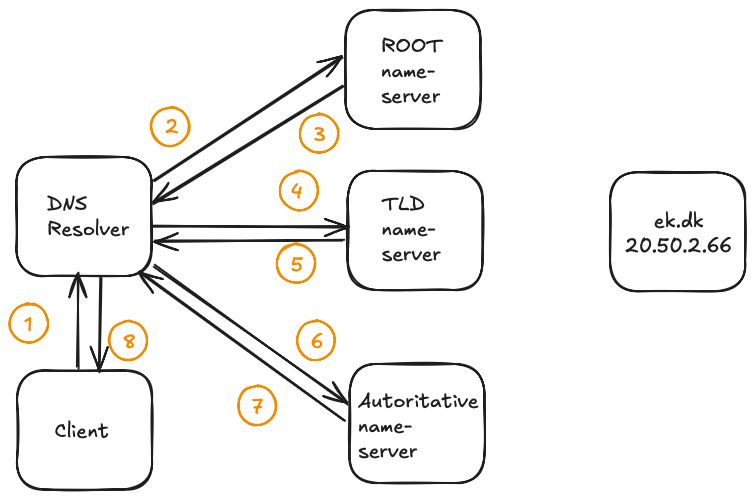
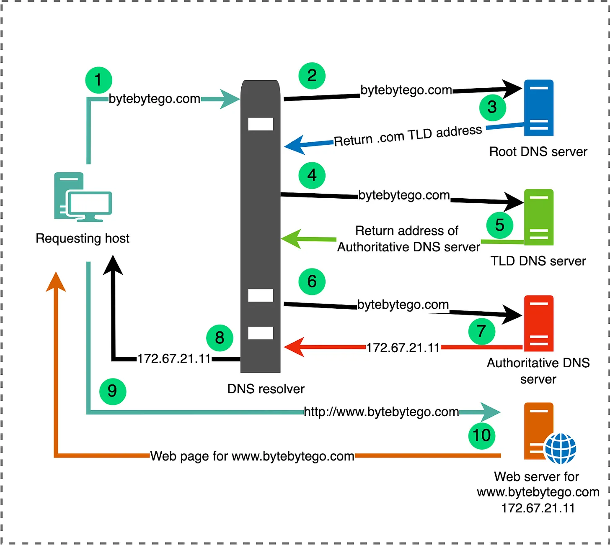
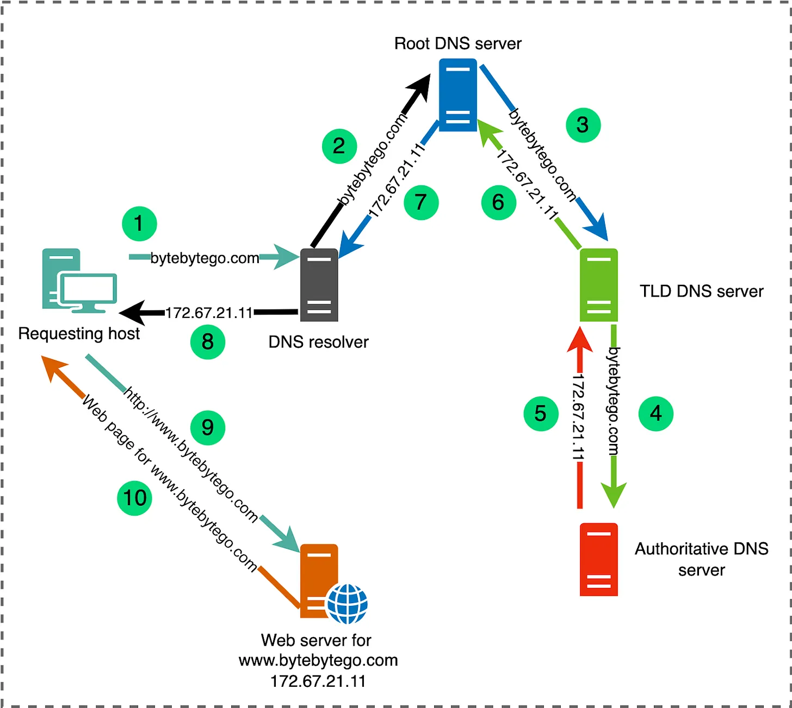
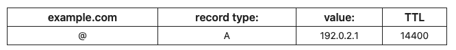
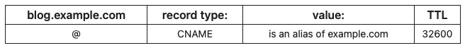
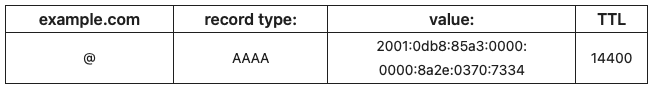
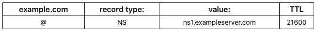
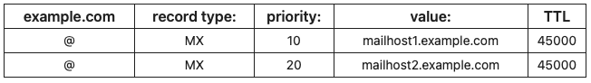

<div class="title-card">
    <h1>DNS Resolution</h1>
</div>


---

# DNS Resolution Process

What happens when you type in `ek.dk` in your browser and hit enter?

How does it know the IP address of the server hosting the website?

This is the process of **DNS resolution**: translating a human-readable domain name into an IP address that computers can understand.


---

# Recursive vs Authoritative Resolvers

There are two types of DNS resolvers:

- **Recursive query**: The DNS server actively queries servers until it finds the answer or an error.

- **Iterative query**: The DNS server queries other servers which continue the process until the final answer is found.client to another DNS server.

When you type a URL into your browser, your computer sends a **recursive query** to a DNS resolver (provided by ISP, Google DNS, Cloudflare DNS). The resolver then performs **iterative queries** to find the authoritative DNS server for the domain and retrieve the corresponding IP address.

---

# Visualization of a DNS resolution

When you type a URL into your browser, your computer initiates a **DNS query** to resolve the domain name to an IP address.



Step 1 and 8 are recursive queries, while steps 2–7 are iterative queries.

---

# The 8 steps in DNS Translation (hostname -> IP Address)

1. Your computer asks a **recursive resolver** (usually provided by your ISP or a public DNS service like Google DNS or Cloudflare DNS) to resolve the domain name.
2. The recursive resolver asks a **root nameserver** for the TLD (e.g., `.dk`).
3. The root nameserver responds with the address of a **TLD nameserver** for `.dk`.
4. The recursive resolver then asks the TLD nameserver for the domain (e.g., `ek.dk`).
5. The TLD nameserver responds with the address of the **authoritative nameserver** for `ek.dk`.
6. Finally, the recursive resolver asks the authoritative nameserver for the IP address of `www.ek.dk`.
7. The authoritative nameserver responds with the IP address (e.g., `20.50.2.66`).
8. The recursive resolver returns this IP address to your computer.


---

# Public DNS Resolvers

You can use public recursive resolvers instead of your ISP's default DNS servers.

| Logo | IP Address | Provider | Notes |
|------|-----------|----------|-------|
|  | `1.1.1.1` | Cloudflare | Fast, privacy-focused |
|  | `8.8.8.8` | Google | Large infrastructure |
|  | `9.9.9.9` | Quad9 | Security-focused, blocks malware |
|  | `208.67.222.222` | OpenDNS | Family filtering options |
|  | `86.54.11.1` | DNS4EU | Servers in EU and funded by the European Commission |

---

# Changing your DNS resolution server

**MacOS**:

Search in Spotlight for `DNS domains`.

**Windows 11**

Settings > Network & Internet > WiFi (or Ethernet) > DNS server assignment > Edit > Choose Manual > Add your DNS server IPs.


---

# Exercise: Explain the iterative DNS resolution process

*In pairs, one person explains the steps in the image below in their own words.*



Once done, both should the description [here](https://blog.bytebytego.com/i/137372043/how-dns-resolution-works) and discuss differences in explanations afterwards.

---

# Exercise: Explain the recursive DNS resolution process

*In pairs, now the other person explains each step in the image below in their own words.*



[Source](https://blog.bytebytego.com/p/a-crash-course-in-dns-domain-name)


---

<div class="title-card">
    <h1>DNS Records</h1>
</div>

---

# Changing DNS Records

When a domain owner wants to change the IP address associated with their domain name they need to update the DNS records.

DNS records are typically managed by the domain owner through a DNS hosting provider or registrar.

Once changes are made, they need to propagate through the DNS system, which can take time due to caching and TTL values.

The TTL (Time To Live) value of the DNS records determines how long the old IP address will be cached by DNS resolvers before they query the authoritative server again for updated information.

It is common to wait anywhere from a few minutes to 48 hours for DNS changes to fully propagate. See a if the DNS has propagated at https://dnschecker.org/.

---

# Types of DNS Records

Case: Deploying to a new server (IP Address) requries updating the DNS records.

| Record | Full Name | Description |
|--------|-----------|-------------|
| **A** | Address | Domain → IPv4 address (ek.dk → 195.254.168.52) |
| **AAAA** | IPv6 Address | Domain → IPv6 address |
| **CNAME** | Canonical Name | Domain → domain (www.ek.dk → ek.dk) |
| **MX** | Mail Exchange | Which email server handles incoming mail for the domain |
| **TXT** | Text | Free text: used for verification, antispam, etc. |
| **NS** | Name Server | Which DNS server is authoritative for the domain |
| **PTR** | Pointer | IP address → domain (reverse DNS lookup) |


And more...

---

# Examples of DNS Records in a registrar

| Record | Example |
|--------|---------|
| **A** |  |
| **CNAME** |  |
| **AAAA** |  |
| **NS** |  |
| **MX** |  |


---

# DNS Records Quiz

**1.** The root server doesn't know the IP address of `ek.dk`. It only knows which nameservers are responsible for `.dk`, and refers the resolver to them.

Which record type does the root server answer with?

Try this:

```bash
dig +norecurse ek.dk @a.root-servers.net
```

<details> 
  <summary>Answer</summary>
    NS (Name Server) record.
</details>

**2.** `www.ek.dk` is an alias that resolves to another hostname. Which DNS record defines this?

<details> 
  <summary>Answer</summary>
    The CNAME (Canonical Name) record. 
</details>

---

# DNS Records Quiz - II

**3.** Email for the `protonmail.com` domain is handled by an SMTP server. Which DNS record specifies which server receives the mail and what are the hostnames of the servers?

Try this:

```bash
dig +short MX protonmail.com
```

<details> 
  <summary>Answer</summary>
    MX (Mail Exchange) record. mail.protonmail.ch and mailsec.protonmail.ch. The numbers are the priority, the lower the number, the higher the priority.
</details>

**4.** Look up a website in https://dnschecker.org and try to understand the different records.


---

# `dig` examples

By default `dig` looks up the **A record** and prints a verbose answer.

```bash
$ dig ek.dk
```

---

# Try these `dig` commands

```bash
# Short output – just the answer
$ dig +short ek.dk

# Look up a specific record type
$ dig MX ek.dk
$ dig +short MX protonmail.com
$ dig NS ek.dk
$ dig TXT ek.dk
$ dig AAAA google.com        # IPv6

# Reverse lookup (IP → domain)
$ dig -x 195.254.168.52

# Follow the full resolution from the root servers
$ dig +trace ek.dk

# Ask a specific DNS server (here Cloudflare)
$ dig @1.1.1.1 ek.dk

# Show only the answer section
$ dig +noall +answer ek.dk
```

*Try `dig +trace ek.dk` and watch it walk down: root → `.dk` → authoritative nameserver.*


---

# Helpful tool for troubleshooting server problems

https://isitdns.com/
