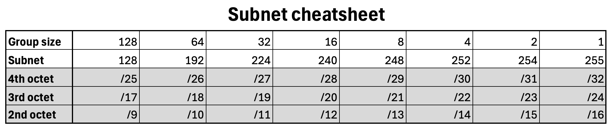

# Subnetting cheatsheet

## CIDR Notation
- CIDR (Classless Inter-Domain Routing) notation is a compact representation of an IP address and its associated network mask.
- It consists of an IP address followed by a slash (`/`) and a number (e.g., `/24`).
- The number indicates how many bits are used for the network portion of the address.

## Subnet Mask
- The subnet mask is a 32-bit number that divides the IP address into network and host portions.
- It is often represented in dotted-decimal notation (e.g., `255.255.255.0`).
- The subnet mask can be derived from CIDR notation. For example, `/24` corresponds to `255.255.255.0`.

## Calculating Subnets

