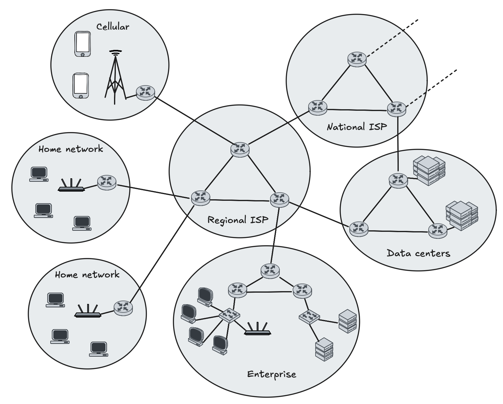

    <h1>Missing Slides from Last Week</h1>

---

# IP to Location

https://www.ip2location.com/

https://iplocation.io/

There are libraries and paid services that provide more accurate geolocation data.

But remember, they are never perfect. IP addresses can be reassigned and users can use VPNs or proxies to mask their true location.

---

# The Internet = A network of networks

---

# ISP (Internet Service Provider)

Who is your ISP and who owns the infrastructure that connects you to the Internet?

Check it out here: https://tjekditnet.dk/

---

# IXP (Internet Exchange Point)

[DIX (Danish Internet Exchange)](https://www.dix.dk/) is in Lyngby.

The largest IXP in Denmark. All major Danish ISPs are connected to DIX and exchange traffic between each other.

The hackerspace [Labitat](https://ix.labitat.dk/) runs one in Copenhagen.

A map of IXPs around the world can be found here: https://www.internetexchangemap.com/.

---

# CDN (Content Delivery Network)

A CDN is a network of servers that are distributed across multiple locations to deliver content closer to users.

Some CDNs are placed at IXPs to reduce latency and improve performance.

Large companies like Cloudflare, Akamai, and Amazon CloudFront provide CDN services.

---

# VPN

*Do you know what VPNs are?*

*What can they be used for?*

More explanations will follow in the homework titled: **Try out a VPN**.
