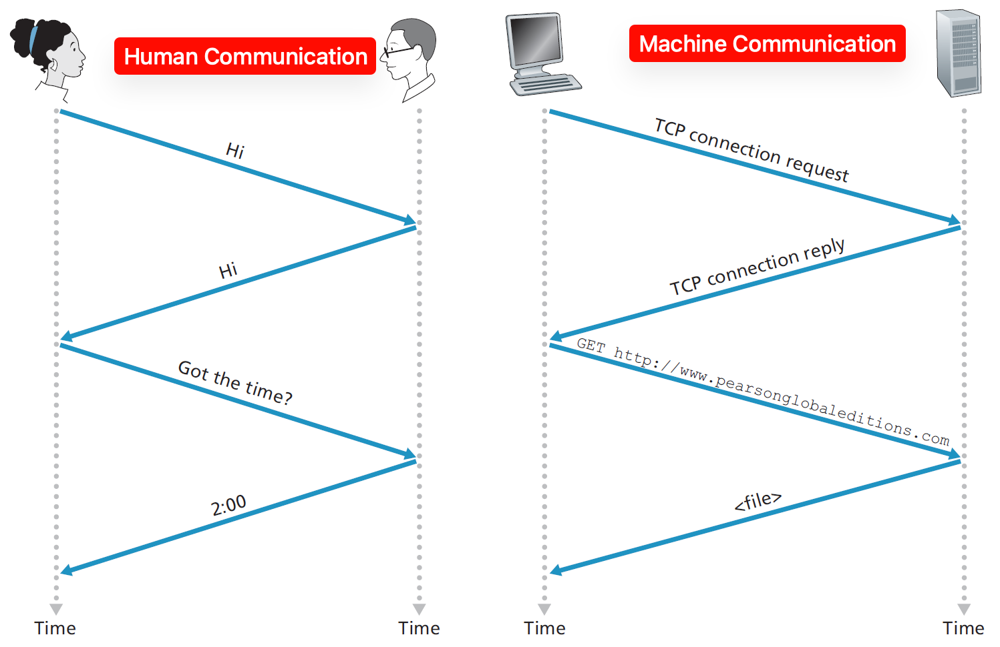

    <h1>Protocols</h1>

---

# The Internet?

*What is the Internet?*

*What is the World Wide Web?*

*Have you ever wondered how your computer can communicate with other computers around the world?*

**Motivation**: You use it every day but can you explain what it is?

---

# The Internet!

A global network of interconnected computers (infrastructure) that communicate with each other using standardized protocols.

**Last week**: The network part.

**This week**: The communication / protocols part.

---

# The World Wide Web

The web is a service that runs on top of the Internet, allowing users to access and share information through a stack of protocols that we will explore today. 

The protocols have evolved over time to solve various problems and to accommodate new technologies and applications. 

---

# Disclaimer: Historical Note

Previously, Datamatiker spent almost the entire semester teaching networking.

Now, only a single week is dedicated to TCP/IP. Do not fret if the topic feels overwhelming and confusing.

The erhvervsakademi focus is to give a baseline understanding and provide name recognition to aid with debugging network issues when deploying applications at a company in the future. 

The subject is highly theoretical but the goal is practical.

---

# The importance of networking as a programmer

Your end goal is to deploy applications.

Understanding networking is crucial for:

* Properly configuring servers and services.

* Debugging network-related issues.

* Optimizing performance.

* Ensuring security.

---

# What is a protocol?

A set of rules that govern how two parties communicate.

Protocols define the format, timing, sequencing, and error handling of data communications.

Source: Kurose & Ross, Computer Networking: A Top-Down Approach, 7th Edition (2016)

(Fun Fact: Computers synchronize time over the [Network Time Protocol](https://en.wikipedia.org/wiki/Network_Time_Protocol).)

---

# Anything can be a protocol

Anyone can make up a protocol. The challenge is to get others to adopt it. 

*Which human protocols are you familiar with?*

 
  
Example

   I ask a question. The class raises their hands.

 
  
Example

   How's it going? Oh, I'm doing great! (They are not doing great in fact.)

 
  
Example

   Knock knock. Who's there?...

---

# Network Protocol

A protocol is a set of rules that govern how data is transmitted and received over a network.

Different protocols operate at different layers of the OSI or TCP/IP model.

