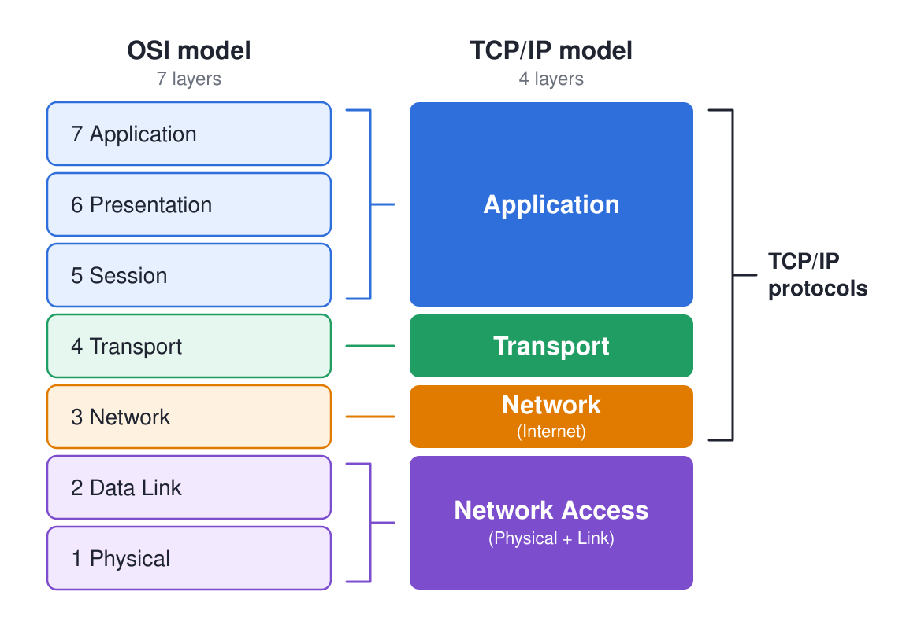
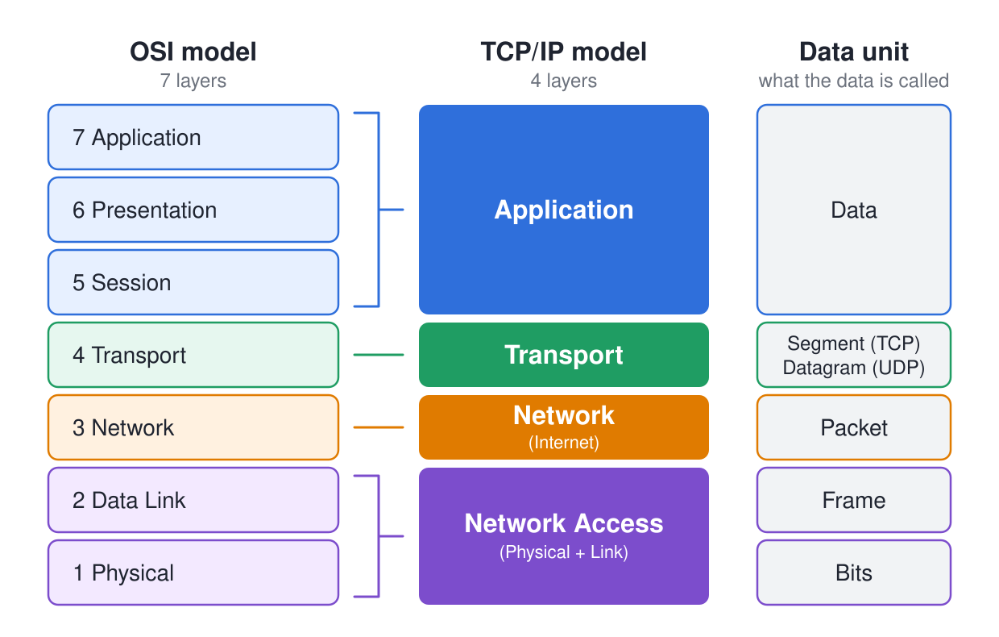
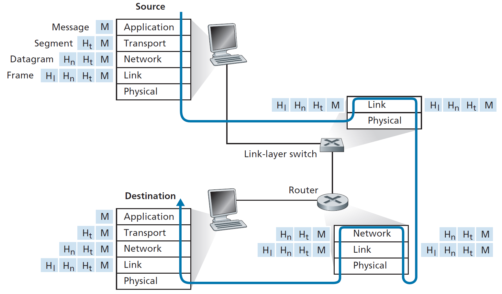
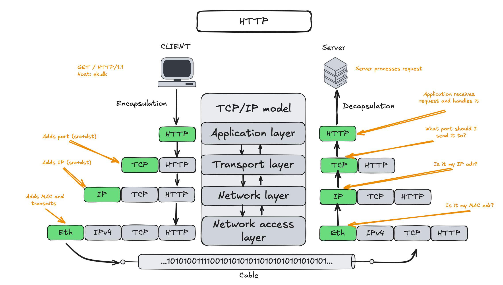
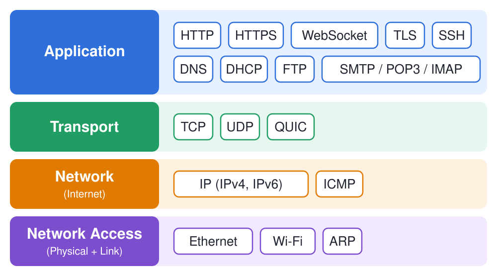

    <h1>Network Layers</h1>

---

# Seeing the Internet in layers

**Question**: How many layers are there in the Internet?

**Answer**: It depends on the model you use. The two most common models are:

* the [OSI model](https://en.wikipedia.org/wiki/OSI_model) (7 layers) 

* the [TCP/IP model](https://en.wikipedia.org/wiki/Internet_protocol_suite) (4 layers).

---

# OSI vs. TCP/IP Model

These models are a family of protocols that are the foundation of the Internet.

**P**lease **D**o **N**ot **T**hrow **S**ausage **P**izza **A**way.

---

# Layers of TCP/IP

1. **Application Layer**: Protocols that interface with end-user applications (HTTP, DNS, FTP...).

2. **Transport Layer**: Ensures reliable data transfer between devices (TCP, UDP...).

3. **Network Layer** (also called the Internet layer): Handles routing of data packets across networks (IP, ICMP...).

4. **Network Access Layer**: Physical connection and local delivery (Ethernet, Wi-Fi, MAC addresses...).

---

# OSI vs TCP/IP Model - What the data is called at each layer

---

# TCP/IP Layers Routing Through the Internet

Source: Kurose & Ross, Computer Networking: A Top-Down Approach, 7th Edition (2016)

---

# Encapsulation - Decapsulation

---

# OSI Layer Devices

**L5-L7 Devices**: Application servers, web servers, email servers, database servers.

**L4 Devices**: Firewalls, load balancers, proxy servers.

**L3 Devices**: Routers, layer 3 switches.

**L2 Devices**: Switches, bridges, access points (APs).

**L1 Devices**: Hubs, repeaters, cables, network interface cards (NICs).

---

    <h1>Quiz Yourself - TCP/IP Model Layers</h1>

---

# Quiz Yourself - TCP/IP Model Layers

This is a self-study exercise. After the lecture, return to these slides and quiz yourself.

Refresh your knowledge:

---

# TCP/IP Model Quiz

Name the layer responsible for each task.

**1.** Routing data across the Internet between networks.

Answer

Network layer (IP). It picks the path from one network to the next.

**2.** Delivering data reliably and in order, retransmitting what gets lost.

Answer

Transport layer (TCP). UDP also lives here, but trades reliability for speed.

**3.** Putting bits onto the physical wire / Wi-Fi to the next device.

Answer

Network Access (Link) layer.

**4.** Connecting a client to a server..

Answer

Application layer.

---

# TCP/IP Model Quiz — What is the layer

| Protocol | Explanation | Layer |
|---|---|---|
| HTTP / HTTPS | Transfers web pages between browser and server | ? |
| FTP | Transfers files between client and server | ? |
| NFS | Mounts and accesses files on a remote server | ? |
| SSH | Provides a secure remote shell / terminal session | ? |
| SMTP / IMAP | Sends / retrieves email | ? |
| DNS | Resolves domain names to IP addresses | ? |
| DHCP | Hands out IP addresses to devices joining a network | ? |
| TCP / UDP | Delivers data between hosts (reliable vs. fast) | ? |
| IP | Addresses and routes packets across networks | ? |
| ICMP | Carries error / diagnostic messages (ping, traceroute) | ? |
| Ethernet / Wi-Fi | Moves bits over the physical link to the next device | ? |
| ARP | Maps an IP address to a hardware (MAC) address | ? |

---

# Match the Protocol - Solution

| Protocol | Layer |
|---|---|
| HTTP / HTTPS | Application |
| FTP | Application |
| NFS | Application |
| SSH | Application |
| SMTP / IMAP | Application |
| DNS | Application |
| DHCP | Application |
| TCP / UDP | Transport |
| IP | Internet |
| ICMP | Internet |
| Ethernet / Wi-Fi | Network Access |
| ARP | Network Access |
