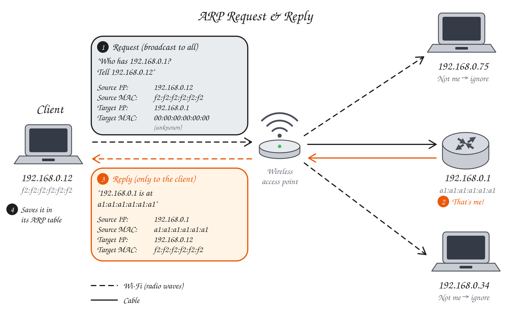

    <h1>The Network Access Layer</h1>

---

# Network Access Layer (Physical + Link)

**The Physical Layer** turns bits into signals (electrical voltage, light pulses or radio waves) and back again.

**The Link Layer** is responsible for moving data between devices on the same network. Handles MAC addressing, error detection and framing.

*Can you think of any physical media used for transmitting data?*

Hint

Don't let the name "physical" throw you off. It includes both wired and wireless media.

---

# Physical Layer Examples

| Technology | Medium | Description |
|---|---|---|
| **Ethernet** | Copper twisted pair or fiber | Wired local networks. |
| **Wi-Fi** | Radio waves | Wireless local networks. |
| **Fiber Optic** | Light in glass fiber | High speeds over long distances. |
| **Coaxial Cable** | Copper coax | Cable Internet and TV. |
| **Satellite** | Radio waves | Internet access in remote areas. |
| **Cellular** | Radio waves | Mobile Internet access (4G, 5G). |
| **Bluetooth** | Radio waves | Short-range connections between devices. |

---

# MAC (**M**edia **A**ccess **C**ontrol) Addresses

Each network interface card (NIC) has a MAC address: a 48-bit unique identifier.

Example: `a4:83:e7:1f:2c:9b`.

Each manufacturer gets a unique prefix and the last 3 bytes are unique to the device.

Virtual MAC addresses exist.

*Why do we need IP addresses if we have MAC addresses?*

Because MAC addresses say nothing about the device's location in the network.

---

# ARP (**A**ddress **R**esolution **P**rotocol)

A protocol used to map an IP address to a MAC address within a local network.

1. The client broadcasts to everyone: "Who has `192.168.0.1`? Tell `192.168.0.12`."
2. Everyone else ignores it. Only the owner answers.
3. The owner replies only to the client with its MAC address.
4. The client caches the answer in its ARP table.

To see your ARP table: `$ arp -a`.

