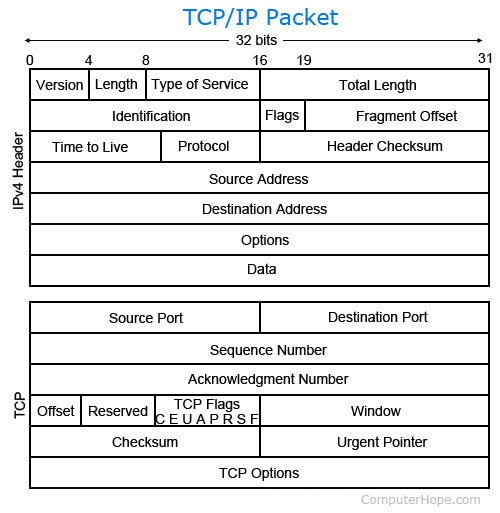
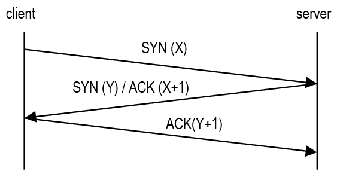
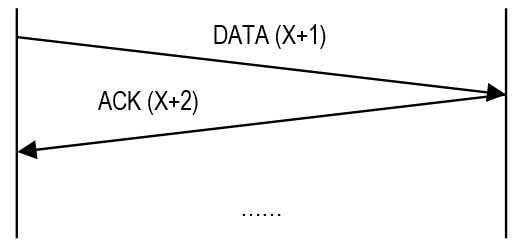
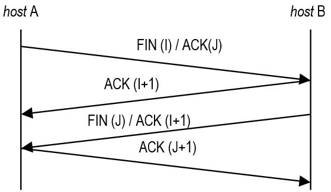

    <h1>The Transport Layer</h1>

---

# The Transport Layer

Responsible for delivering data from one application to another, across the network.

**Protocols**: TCP, UDP, QUIC...

---

# TCP (Transmission Control Protocol)

| Feature | Description |
|---|---|
| Connection-oriented | A connection is set up with a 3-way handshake (SYN → SYN-ACK → ACK) |
| Reliable | Lost segments are retransmitted |
| Use of acknowledgements | The receiver confirms what it has received |
| Error checking | A checksum detects corrupted segments |
| Segment order control | Sequence numbers let the receiver put segments back in order |
| Segmentation | Data is segmented for transmission, and reassembled in order at the destination |
| Flow control | The sender slows down so it doesn't overwhelm the receiver |
| Congestion control | The sender slows down so it doesn't overwhelm the network |

---

# Packets

[A formatted unit of data](https://en.wikipedia.org/wiki/Network_packet).

At the transport layer, TCP calls it a segment and UDP a datagram. They are [encapsulated](https://en.wikipedia.org/wiki/Encapsulation_(networking)): TCP segment → inside an IP packet → inside an Ethernet frame.

---

# Packet Loss Causes

Causes could be anything from:

- congestion in the network from too much traffic

- misconfigured network equipment

- broken cables

- network equipment prioritizing some traffic over others

- temporary routing issues, e.g. loops where the packet's TTL runs out

...and more.

Packets sent to the same destination can take different paths through the network.

---

# TCP connection and data transfer

## Connection (3-way Handshake)

## Data Transfer

## Disconnection (4-way Handshake)

Source: 2014 Mora-Rioja & Rodríguez Villafáfila

---

# Exercise: Act out TCP

With a partner, one chooses **host A** and the other chooses **host B**.

Act out the three phases of TCP: 

1. Connection

2. Data transfer

3. Disconnection.

---

# UDP (User Datagram Protocol)

| Feature | Description |
|---|---|
| Connectionless | No handshake, datagrams are sent right away, so there is no delay due to connection establishment |
| Unreliable | Lost datagrams are not retransmitted |
| Lack of acknowledgements | The sender never knows whether a datagram arrived |
| Error checking | A checksum detects corrupted datagrams, which are dropped |
| Unordered | No sequence numbers and no sorting mechanism, so datagrams can arrive in any order |
| No congestion control | The sender never slows down, so there is no delay due to congestion control |
| Small header overhead | 8 bytes vs. TCP's 20 bytes (minimum) |
| Fast | Less work per datagram and no waiting for acknowledgements |

---

# Use Cases for UDP

*Given the previous slide, can you imagine use cases for UDP?*

Answer

Data transfer where speed is more important than reliability, such as: video calls, online gaming, voice over IP (VoIP) and other real-time applications.

---

# TCP vs UDP

| TCP | UDP |
| --- | --- |
| **Protocols:** WebSockets, HTTP(S), FTP, SSH, SMTP / IMAP | **Protocols:** DNS, DHCP, VoIP, streaming protocols |
| 👍 Reliable | 👍 Fast |
| 👍 Ordered | 👎 Unreliable |
| 👎 Slower than UDP | 👎 Unordered |

---

# A quick note about QUIC

Developed by Google.

Ensures reliable transport over UDP.

Base protocol for HTTP/3.

As of August 2026, [40% of all websites](https://w3techs.com/technologies/details/ce-http3) use HTTP/3.

Already in 2020, [75% of Meta's traffic](https://engineering.fb.com/2020/10/21/networking-traffic/how-facebook-is-bringing-quic-to-billions/) used QUIC.

---

# Ports

The IP address gets data to the right device. The port number gets it to the right application.

A 16-bit number: `0` to `65535`.

* `0`–`1023`: Well-known ports (HTTP, SSH...).

* `1024`–`49151`: Registered ports (MySQL, PostgreSQL...).

* `49152`–`65535`: Dynamic ports, picked by the client for its side of the connection.

---

# Network Protocols and Port Number Associations

| Port | TCP | UDP | Protocol |
|---|:---:|:---:|---|
| 21 | ✓ | | FTP (file transfer) |
| 22 | ✓ | | SSH (secure shell, SFTP, SCP) |
| 25 | ✓ | | SMTP (sending email) |
| 53 | ✓ | ✓ | DNS (domain name lookup) |
| 67 / 68 | | ✓ | DHCP (assigning IP addresses) |
| 80 | ✓ | | HTTP (web traffic) |
| 110 / 143 | ✓ | | POP3 / IMAP (retrieving email) |
| 443 | ✓ | ✓ | HTTPS (secure web traffic; UDP = QUIC / HTTP/3) |
| 3306 | ✓ | | MySQL database |
| 5432 | ✓ | | PostgreSQL database |

Sources: [IANA Port Number Registry](https://www.iana.org/assignments/service-names-port-numbers) and [Wikipedia — List of TCP and UDP port numbers](https://en.wikipedia.org/wiki/List_of_TCP_and_UDP_port_numbers).

