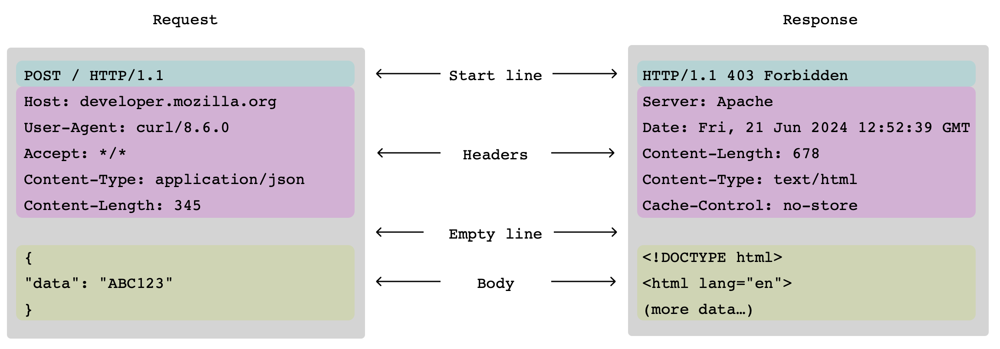
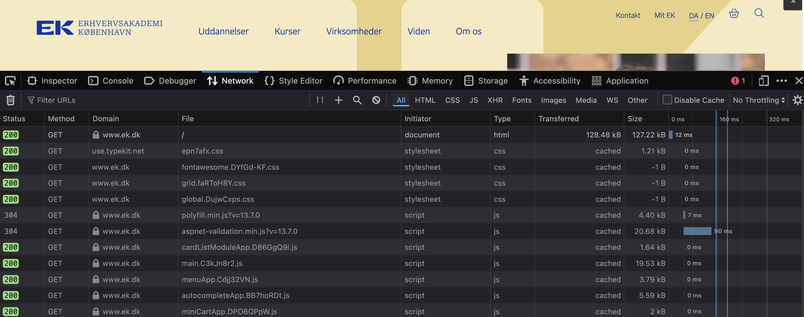
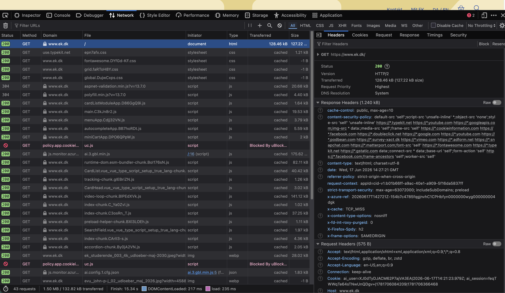
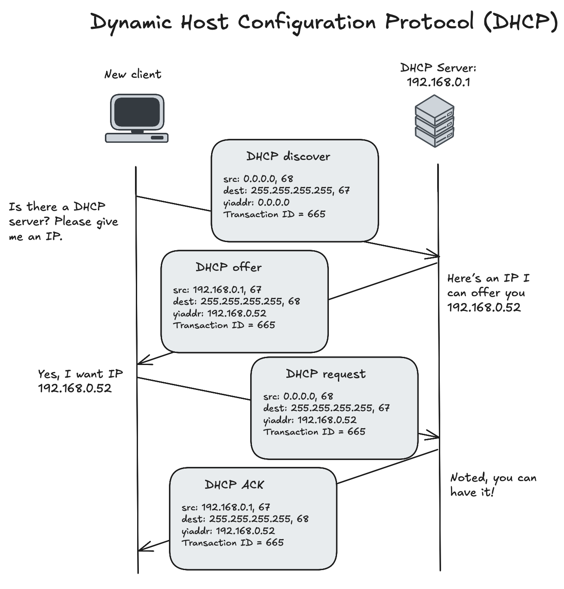

<div class="title-card">
    <h1>The Application Layer</h1>
</div>

---

# The Application Layer

The application layer is the top layer of the TCP/IP model. It provides protocols that applications use to communicate over the network.

**Protocols**: HTTP, HTTPS, FTP, SMTP, DNS, DHCP...

---

<div class="title-card">
    <h1>HTTP</h1>
</div>d

---

# HTTP

**H**yper**T**ext **T**ransfer **P**rotocol is a data communication protocol used for transmitting hypermedia (documents containing links to other resources). The foundation of the World Wide Web. 

Developed by Tim Berners-Lee at CERN together with HTML and the URL (**U**niform **R**esource **L**ocator) format for accessing resources.

---

# HTTP/2 and HTTP/3

You will be taught the principles of HTTP/1.1 because it gives you sufficient foundation to understand the protocol.

Understanding the newer versions is beyond the scope of this course. If you are curious, have a [look here](https://alexandrehtrb.github.io/posts/2024/03/http2-and-http3-explained/).

In short, they add improvements to performance, such as multiplexing, header compression as well as security (encrypted by default).

HTTP/1.1 and HTTP/2 use TCP, while HTTP/3 uses QUIC.

---

# General HTTP structure

```plaintext
+---------------------------------------+
| Start Line (req) OR Status Line (res) | <- Method, Path, Version OR Version, Status Code
+---------------------------------------+
| Headers                               | <- Key-Value pairs
+---------------------------------------+
| Blank Line                            | <- CRLF to indicate end of headers
+---------------------------------------+
| Body [optional]                       | <- Body content
+---------------------------------------+
```

*How does it know how long the status line and headers are?*

*What separates the headers from the body?*

---

# HTTP line endings

CRLF = Carriage Return + Line Feed ends every line. An empty line (just CRLF) marks the end of the headers section.

This is done because the headers section can be of variable line length.

- **CR** (Carriage Return) = (ASCII 13) or `\r` - `0x0D` in hex
- **LF** (Line Feed) = (ASCII 10) or `\n` - `0x0A` in hex

---


# HTTP Request

Modern text editors do not show the line endings but they are still there. 

Here is an example of a GET request (with line endings shown):

```plaintext
GET /books HTTP/1.1\r\n
Host: www.example.com\r\n
User-Agent: curl/8.7.1\r\n
Accept: application/json\r\n
\r\n
```

---

# HTTP Response

Here is an example of a response (without line endings this time):

```plaintext
HTTP/1.1 200 OK
Content-Type: application/json
Content-Length: 151

{
  "books": [
    {"id": 1, "title": "1984", "author": "George Orwell"},
    {"id": 2, "title": "To Kill a Mockingbird", "author": "Harper Lee"}
  ]
}
```


---

# Client-Server Model

HTTP *can* be used to exchange data between two servers. But on a daily basis you act as a client (through a web browser or mobile app) and use HTTP to retrieve resources from servers.


---

# HTTP Structure: Request and Response

In the client-server model, communication happens in a **request-response cycle**.



[Source](https://developer.mozilla.org/en-US/docs/Web/HTTP/Guides/Messages)


---


# How to view HTTP requests and responses in your browser

*How can you view the HTTP requests and responses in your browser?*


---

# HTTP Requests and Responses in the Browser




---

# Status Codes

HTTP responses include a status code that indicates the result of the request. Status codes are grouped into five classes:

| Class   | Meaning                | Examples                                          |
| ------- | ---------------------- | ------------------------------------------------- |
| **1xx** | Informational responses | `100 Continue`                                    |
| **2xx** | Successful responses    | `200 OK`, `201 Created`                           |
| **3xx** | Redirection messages    | `301 Moved Permanently`, `302 Found`              |
| **4xx** | Client error responses  | `400 Bad Request`, `404 Not Found`                |
| **5xx** | Server error responses  | `500 Internal Server Error`, `503 Service Unavailable` |

[Full List of HTTP Status Codes](https://developer.mozilla.org/en-US/docs/Web/HTTP/Status).

---

# HTTP Methods / Verbs

Hopefully a repetition of the Programming classes.

| Method  | Description                                                                 |
| ------- | --------------------------------------------------------------------------- |
| **GET** | Retrieve data from the server (can send data in the URL).                  |
| **POST** | Create new resources on the server.             |
| **PUT** | Update an existing resource completely.         |
| **PATCH** | Partially update an existing resource. |
| **DELETE** | Remove a resource.                                               |
| **HEAD** | Similar to GET but only retrieves headers. |
| **OPTIONS** | Describe the communication options for the target resource. Often used in CORS preflight requests. |


---

# Accept vs. Content-Type

Two common HTTP headers that serve different purposes:

**Accept**: The client uses the `Accept` header to tell the server which media types it can understand.

**Content-Type**: The sender (client or server) uses the `Content-Type` header to indicate the media type of the body.

*In a `fetch` request, which of the above headers is used to indicate that the request body contains JSON data?*

---


# Fetch Example with the `Content-Type` Header


```javascript
fetch('https://jsonplaceholder.typicode.com/posts', {
    method: 'POST',
    headers: {
        'Content-Type': 'application/json'
    },
    body: JSON.stringify({
        title: 'My first post',
        body: 'Learning about HTTP headers',
        userId: 1
    })
})
.then(response => response.json())
.then(data => console.log(data))
.catch(error => console.error('Error:', error));
```

[JSONPlaceholder](https://jsonplaceholder.typicode.com/) is a free fake REST API.

**Try this**: Run the request in the browser **Console**. 


---

# MIME Types and Payloads

From the previous example, open the **Network** tab, click on the request, and find the `Content-Type` request header you just sent.

What is `application/json`? It is called a MIME type. It is a [standard](https://developer.mozilla.org/en-US/docs/Web/HTTP/Guides/MIME_types/Common_types) way to indicate the format of the data being sent over the Internet.

An HTTP payload is always a sequence of bytes of either text or binary data.

| Text | Binary |
|---|---|
| HTML, CSS, JavaScript, JSON, XML | Images, video, fonts, PDFs, compressed (gzip) data |

The `Content-Type` header tells the recipient how to interpret the bytes.


---

# A single HTTP Request and Response in the Browser

Let's look at the request headers and responses of a single request.




What are the **method**, **URL** and **status code**?

---

# Exercise - Understand an HTTP Request

A client sends the following GET message to an HTTP server. Answer the questions below:

```plaintext
GET /kurose_ross/interactive/quotation3.htm HTTP/1.1
Host: gaia.cs.umass.edu
Accept: text/plain, text/html, image/jpeg, image/png, audio/basic, 
video/mp4, video/mpeg, application/*, */* 
Accept-Language: en-us, en-gb;q=0.5, en;q=0.3, fr, fr-ch, fi, cs
If-Modified-Since: Fri, 11 Jan 2019 20:08:45 GMT
User-Agent: Mozilla/5.0 (Windows NT 6.1; WOW64)  AppleWebKit/
	535.19 (KHTML, like Gecko) Chrome/18.0.1025.162 Safari/535.19
```

1. What is the name of the file that is being retrieved?
2. What version of HTTP is the client running?
3. What media formats does the client browser prefer to receive?
4. What languages is the browser willing to accept?
5. Does the client already have a copy of the requested file?
6. What type of browser and operating system does the client have? (Hint: It is the browser with the most specific version number.)

---

# Understand an HTTP Request - Solution

1. `quotation3.htm` (request line)

2. HTTP/1.1 (request line)

3. All listed formats equally, and `*/*` means anything (`Accept`)

4. US English, British English, English, French, Swiss French, Finnish, Czech (`Accept-Language`)

5. Yes, last modified 11 Jan 2019. (`If-Modified-Since`)

6. Chrome 18 on Windows 7 (`User-Agent`)

---

# Exercise - Understand an HTTP Response

The server sends the following response message to an HTTP client. Answer the questions below:

```plaintext
HTTP/1.1 200 OK
Date: Fri, 11 Jan 2019 20:38:38 GMT
Server: Apache/2.2.3 (CentOS)
Last-Modified: Fri, 11 Jan 2019 20:31:38 GMT
ETag: "17dc6-a5c-bf716880"
Content-Length: 4443
Keep-Alive: timeout=33, max=93
Connection: Keep-alive
Content-Type: text/html
```

1. Was the server able to send the document successfully?
2. At what date and time was this response sent?
3. When was the file last modified on the server?
4. How many characters are there in the document being returned?
5. What is the type of file being sent by the server in response?
6. What is the name of the server, its version and what OS does it run on?

---

# Understand an HTTP Response - Solution

1. Yes, `200 OK` (status line)

2. Fri, 11 Jan 2019 20:38:38 GMT (`Date`)

3. Fri, 11 Jan 2019 20:31:38 GMT (`Last-Modified`)

4. `4443` bytes (`Content-Length`)

5. HTML (`Content-Type`)

6. Apache 2.2.3 on CentOS (`Server`)

---

<div class="title-card">
    <h1>HTTPS</h1>
</div>

---

# HTTP**S**

**Problem**: Everything sent over HTTP is visible to anyone who can intercept the communication.

HTTP**S** encrypts the entire request and response, including the path in the URL, headers and body.

HTTPS will not encrypt the domain name in the URL, so an eavesdropper can still see which website you are visiting. *Why is that?*

<details> 
  <summary>Answer</summary>
   The domain is sent before encryption starts: in the DNS lookup and in the TLS handshake (SNI). Routers only need the IP address.
</details>

Default port: `443`.

First implemented with **SSL** but replaced by **TLS**. The name SSL stuck, so people often say SSL when they mean TLS.

---

# Certificate Authorities (CAs)

1. Browsers and operating systems come with a list of trusted CAs (Certificate Authorities).
2. A website owner asks a CA for a certificate and proves that they control the domain, for example by adding a DNS record or placing a file on the web server.
3. The CA issues and signs a TLS certificate (often still called an SSL certificate), which proves that the server really is the domain it claims to be.
4. The certificate is installed on the web server.
5. When you open the website, the server sends the certificate and the browser checks that it is signed by a trusted CA, matches the domain and hasn't expired.

[Let's Encrypt](https://letsencrypt.org/) is a free CA that automates this.

---

# Which CAs Does Your Computer Trust?

Your operating system comes with a list of trusted root CAs.

**MacOS**: 

Spotlight → type `Keychain Access` → in the prompt, choose **Open Keychain Access** → **System Roots**

**Windows**:

Press `Win + R`, type `certmgr.msc` → Trusted Root Certification Authorities → Certificates

---

# Find the CA that signed a website's certificate

1. Go to a website in your browser (`https://ek.dk`).

2. Click on the padlock icon to the left of the URL → **Connection is secure** → **Certificate is valid**.

3. See the **Verified By** / **Issued By** field. This is the CA that signed the website's certificate.

4. Do you recognize the CA from your computer's list of trusted root CAs?

---

# TLS Handshake in action

Let's look at the verbose (`-v`) output of a cURL request:

```bash
$ curl -v -o /dev/null https://www.ek.dk
```

Windows users, use Git Bash for the above command.

*Can you see who issued the certificate?*

<details>
  <summary>Answer</summary>
   Given <code>* issuer: C=US; O=DigiCert Inc; OU=www.digicert.com; CN=GeoTrust TLS RSA CA G1</code>, the certificate was issued by GeoTrust TLS RSA CA G1, a CA owned by DigiCert.
</details>


---

# S is for Security

The ancient protocols below have been extended with a secure version that uses encryption (confidentiality) to protect data in transit. Usually signaled by an `S`.

*With your own words, can you define confidentiality in this context?*

| Insecure | Secure | What the "S" adds |
|---|---|---|
| HTTP  | HTTP**S**  | TLS encryption (web traffic) |
| FTP   | FTP**S**   | TLS encryption (file transfer) |
| SMTP  | SMTP**S**  | TLS for sending email |

Example of a protocol designed to be secure: SSH (**S**ecure **Sh**ell), which replaced Telnet.

---

# FTP (File Transfer Protocol)

FTP is very useful for transferring files. Try it out with the following public server: 

```bash
$ curl -u demo:password ftp://test.rebex.net/readme.txt -o readme.txt
```

**Note**: One would usually use the `ftp` command directly, but it isn't installed by default on all systems so `cURL` acts as the FTP client in the command above.


---

# DHCP (**D**ynamic **H**ost **C**onfiguration **P**rotocol)

When a device joins a network, it has no IP address. DHCP gives it one, along with the subnet mask, default gateway and DNS server.

1. **Discover**: The client broadcasts "Is there a DHCP server?"
2. **Offer**: The server offers an IP address.
3. **Request**: The client asks for the offered address.
4. **Acknowledge**: The server confirms.

Runs over UDP (ports `67` / `68`). At home, your router is usually the DHCP server.

---

# DHCP in action




---

# Cookies

**Problem**: How does the server know who you are?

This is solved with **cookies**:

1. The server sends a `Set-Cookie` header with a unique session ID (SID).
2. The browser stores the cookie and sends it back in a `Cookie` header with every request.

Where to find cookies in your browser:

**Firefox**: DevTools >  Storage > **Cookies** (Choose the domain). 

**Chromium**: DevTools > Application > **Cookies** (Choose the domain).

Alternatively, in the `Console` tab, run `document.cookie` (it won't show session cookies).

---

# Let's look at cookies for `dr.dk`

Go to `dr.dk` and check the cookies.

*Can you find the session cookie?*

*What other cookies do you see?*

*What is the expiration of the cookies? Are there cookies that won't expire?*


