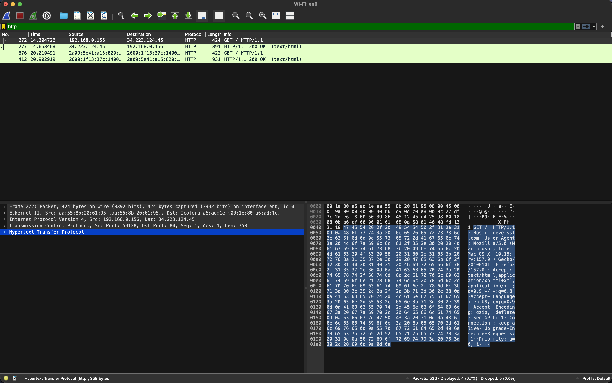

    <h1>Wireshark</h1>

---

# Wireshark

Wireshark is a packet sniffer. It captures and analyzes network traffic in real time.

Used professionally for network troubleshooting and analysis.

Cyber security specialists rely heavily on Wireshark.

---

# Choosing a Network Interface

After opening the application, you must first choose a network interface to capture traffic from:

| Network interface | macOS | Windows | Linux |
|---|---|---|---|
| A wireless network card | `Wi-Fi: en0` | `Wi-Fi` | `wlan0` / `wlp2s0` |
| A wired network card | `Ethernet: en4` | `Ethernet` | `eth0` / `enp3s0` |
| The loopback interface (virtual, traffic to the machine itself) | `lo0` | `Adapter for loopback traffic capture` | `lo` |
| Virtual Private Network tunnels (VPN) | `utun4` | Named after the VPN client | `tun0` / `wg0` |

You can see a live graph of the traffic next to each interface.

---

# Exercise: See the 4 Layers in One Packet

1. Open **Wireshark** → double-click your **Wi-Fi** interface.
2. Filter: `http` *(plain HTTP — HTTPS would be encrypted)*. You can find the filter input box below the icons. A filter hides all traffic except what matches, e.g. `dns`, `arp` or `ip.addr == 8.8.8.8`.
3. Visit `http://neverssl.com` to generate traffic. The site intentionally uses plain HTTP.
4. Click the `GET / HTTP/1.1` packet and expand each row in the middle pane:

| Wireshark row | TCP/IP layer |
|---|---|
| Frame / Ethernet II | **Network Access** |
| Internet Protocol | **Network** |
| Transmission Control Protocol | **Transport** |
| Hypertext Transfer Protocol | **Application** |

---

# Exercise: Wireshark Output

*Can you spot the line endings that separates the header and body (`0d 0a`) and the one that indicates the end of the request (`0d 0a 0d 0a`)?*

---

# Packet capture files

Wireshark saves captured traffic in `.pcap` or `.pcapng` files.

These files can be opened for analysis later or shared with others.

1. Let's try to capture some traffic and stop.

2. Save with `CTRL+S` or `CMD+S` and name it `my_capture.pcapng`.

3. Close Wireshark and open the file again to see the captured traffic.

