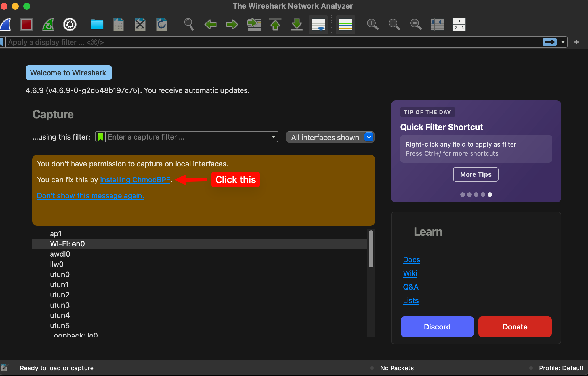

# Install Wireshark

Download and install Wireshark from [the official website](https://www.wireshark.org/download.html).

---

## MacOS

It is as simple as downloading the `.dmg` file and dragging the Wireshark icon to the Applications folder. Choose `Open` when prompted regarding the application being downloaded from the internet.

Linux and MacOS won't have permissions to capture packets on your computer out of the box. This can be solved by installing **ChmodBPF**.

---

## Windows

There are some steps and I've provided a PDF by Erik used in other Tech 2 classes [here](./Install_Wireshark.pdf).

